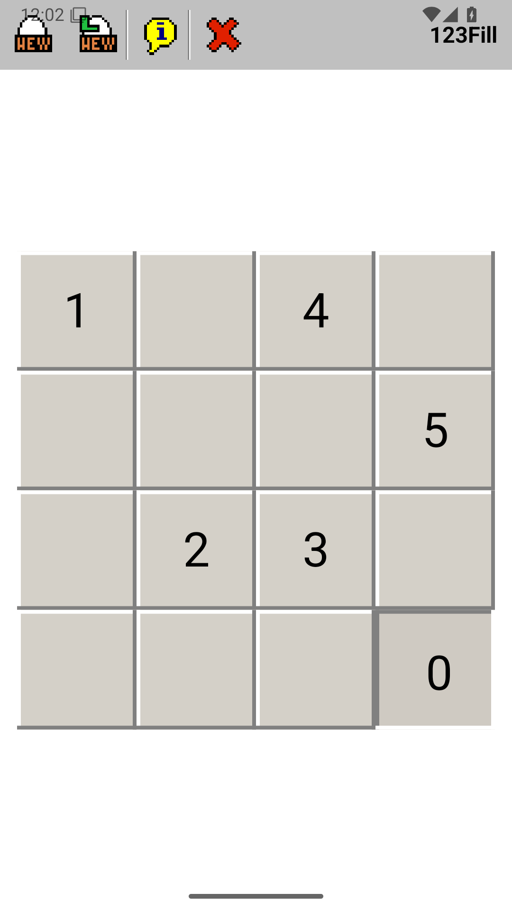

# 1-2-3 Fill for Android

A faithful Android port of the original Win32 puzzle game **1-2-3 fill** by
Roman T. Gritsulyak.



The goal is simple: fill every cell of the field. The figure starts on the cell
numbered `0`, and a numbered cell can only be entered when its number is the
next one in the sequence (`i` -> `i+1`). While the figure stands on a numbered
cell, it may jump back to any numbered cell that has already been reached; this
is the original behaviour that makes levels with repeated numbers solvable.

## What is preserved

- All 29 playable levels, transcribed byte-for-byte from the original
  `game_fields.cpp`.
- The original movement, target-sequence, and jump-back rules.
- The Win32-style grey bevel buttons, black target numbers, and the original
  20x20 monochrome path/head sprites.
- The original toolbar actions: New Game, Level From Beginning (cheat code),
  About, and Exit.
- The original modal dialogs and cheat codes.
- The original `NEXTSTAGE` entry is kept as an end marker; the Android game
  wraps back to `OPAPA` after `FLOWERS` (level 28) instead of trying to play
  the unfinished placeholder.

The untouched original bitmap assets are kept in
`app/src/main/assets/original/` for provenance. Runtime sprites are the same
pixels converted to PNG for Android.

## Requirements

- JDK 17 or newer
- Android SDK with platform 35 and build-tools 35.0.0
- An Android 8.0 (API 26) or newer device/emulator for running the app

## Build locally

The project uses the Gradle wrapper, so no separate Gradle installation is
needed.

```bash
# Point Gradle at your SDK (only needed if ANDROID_HOME is not set)
echo "sdk.dir=$HOME/Android/Sdk" > local.properties

./gradlew testDebugUnitTest
./gradlew assembleDebug
./gradlew assembleRelease
```

The APKs are written to:

- `app/build/outputs/apk/debug/app-debug.apk`
- `app/build/outputs/apk/release/app-release.apk`

Install the debug build on a connected device or emulator with:

```bash
adb install -r app/build/outputs/apk/debug/app-debug.apk
```

### Release signing

`assembleRelease` falls back to the standard Android debug key so that local
and CI builds are immediately installable. For a real release, provide a
keystore through environment variables before running Gradle:

```bash
export ANDROID_KEYSTORE_PATH=/absolute/path/to/release.jks
export ANDROID_KEYSTORE_PASSWORD=...
export ANDROID_KEY_ALIAS=...
export ANDROID_KEY_PASSWORD=...
./gradlew assembleRelease
```

## Tests

Unit tests cover the level data, rules, turn-table geometry, and an exhaustive
solver that proves every bundled level is solvable under the strict original
rules:

```bash
./gradlew testDebugUnitTest
```

End-to-end UI tests launch the real activity on an emulator/device, tap the
custom-drawn board and toolbar through Espresso, play a complete level
(including the jump-back moves), and verify the dialogs and level transition:

```bash
# Start an API 26+ emulator first, then:
./gradlew connectedDebugAndroidTest
```

The e2e suite is in
`app/src/androidTest/java/com/gritsulyak/prevtonextfill/MainActivityE2ETest.java`.

## Continuous integration and releases

`.github/workflows/android.yml` runs on pushes and pull requests:

1. Unit tests and lint.
2. Debug and release APK builds, uploaded as the `android-apks` workflow
   artifact.
3. The instrumentation/e2e suite on API 26 (Android 8.0) and API 35
   emulators.

Pushing a tag such as `v1.0.0` additionally creates a GitHub Release with the
signed release APK attached. If the release signing secrets are configured,
that APK is signed with the real release key; otherwise CI uses the debug key.

Configure these repository secrets for a real release key:

- `ANDROID_KEYSTORE_BASE64` — base64-encoded `.jks` file
- `ANDROID_KEYSTORE_PASSWORD`
- `ANDROID_KEY_ALIAS`
- `ANDROID_KEY_PASSWORD`

For example:

```bash
base64 -w 0 release.jks
```

To build the tagged version manually:

```bash
./gradlew assembleRelease -PversionName=1.0.0 -PversionCode=100
```

## Project layout

```text
app/src/main/java/.../game/    Ported game model and level data
app/src/main/java/.../         Activity, custom board renderer, toolbar
app/src/main/assets/original/  Original Win32 bitmap assets
app/src/test/                  JVM unit tests and exhaustive solver
app/src/androidTest/           Espresso end-to-end UI tests
.github/workflows/android.yml  CI, e2e, and tagged releases
```

## License

This port is distributed under the GNU General Public License v3.0 or later,
the same license as the original game. See [`LICENSE`](LICENSE).

Original game: Copyright (C) 1994-2010 Roman T. Gritsulyak.

Android port: 2026.
